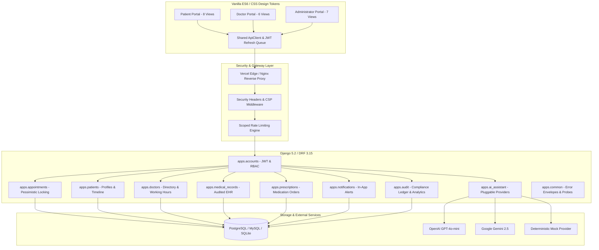

# VakCare — AI-Powered Healthcare Management Platform

[](docs/TESTING_AND_QA.md)
[](requirements.txt)
[](requirements.txt)
[](requirements.txt)
[](LICENSE)

VakCare is an enterprise-grade, full-stack healthcare management web platform connecting **Patients**, **Verified Medical Practitioners**, and **Healthcare Administrators**. It features atomic, race-condition-safe appointment scheduling, electronic health records (EHR), multi-item prescriptions, an intelligent triage AI assistant, and HIPAA-aligned immutable security audit logging.

---

## Master Documentation Suite

Explore the comprehensive in-depth documentation guides:

| Document | Purpose & Scope |
| :--- | :--- |
| **[Architecture & Design Specification](docs/ARCHITECTURE.md)** | System topology, domain partitioning, concurrency model, state machines, defense-in-depth security, and error handling. |
| **[RESTful API Reference](docs/API_DOCUMENTATION.md)** | Complete reference for all 10 domain modules, request/response schemas, query parameters, error codes, and curl examples. |
| **[Database Schema & Data Model](docs/DATABASE_SCHEMA.md)** | Relational ER diagrams, table definitions, column types, constraints, foreign keys, cascade rules, and indexing strategies. |
| **[Frontend Guide & UI Components](docs/FRONTEND_GUIDE.md)** | Modern Vanilla ES6 architecture, CSS token design system, automatic 401 JWT refresh queuing, route guards, and role portals. |
| **[AI Assistant Architecture & Safety](docs/AI_ASSISTANT_ARCHITECTURE.md)** | Pluggable provider engine (OpenAI, Gemini, Mock), safety boundaries, clinical disclaimers, triage logic, and record summarizer. |
| **[Deployment & Operations Manual](docs/DEPLOYMENT_AND_OPERATIONS.md)** | Vercel serverless deployment, Docker/VM production setup, environment variables dictionary, background reminder crons, and health probes. |
| **[Security & Compliance Guidelines](docs/SECURITY_AND_COMPLIANCE.md)** | PHI protection, doctor-patient consultation relationship constraints, sanitized audit logging, security headers, and rate limiting. |
| **[Automated Testing & QA Manual](docs/TESTING_AND_QA.md)** | Pytest test architecture, 68 test case breakdown, test fixtures, coverage reporting, and quality assurance release checklists. |

---

## Key Platform Features

### 1. Patient Portal
- **Specialist Directory Search**: Real-time doctor directory filtered by clinical specialization, consultation fee, and years of experience.
- **Race-Condition-Safe Slot Booking**: Atomic database locking prevents double-booking and slot overlaps.
- **Unified Health Timeline**: Aggregated chronological feed uniting consultations, medical records, and prescribed medications.
- **Electronic Health Records (EHR)**: Audited access to clinical findings, vital metrics (blood pressure, heart rate), and diagnostic notes.
- **Digital Prescriptions**: Detailed medication items showing dosage, administration frequency, course duration, and doctor instructions.
- **AI Health Assistant**: Multi-turn conversational chat for symptom education, specialist recommendations, and plain-language medical record summarization.
- **Notification Center**: Real-time alerts for appointment confirmations, cancellations, reminders, and issued prescriptions.

### 2. Healthcare Practitioner (Doctor) Portal
- **Clinical Dashboard**: Real-time metrics on today's scheduled consultations, pending appointment requests, and active patients.
- **Doctor Daily Schedule**: Time-slotted schedule view for any date with quick-action consultation controls.
- **Appointment State Machine**: Streamlined workflows to **Confirm**, **Reject** with clinical reason, **Cancel**, or mark **Completed**.
- **Clinical History Review**: Access to historical patient records strictly for patients with a verified consultation relationship.
- **EHR & Diagnostics Creator**: Recording of formal consultation notes and structured JSON vital metrics.
- **Prescription Builder**: Dynamic multi-item prescription issuance with automated patient notification dispatch.
- **Schedule Self-Management**: Customization of working hours (`09:00` - `17:00`), consultation fees, and practice availability.

### 3. Platform Administrator Portal
- **Executive Governance Dashboard**: Real-time aggregation of platform KPIs, active practitioners, and system health status.
- **Doctor Credential Verification**: Review of submitted state medical council license numbers with one-click verification approval/revocation.
- **Doctor Account Provisioning**: Administrative onboarding and credential provisioning for licensed medical doctors.
- **User & Patient Registries**: Platform-wide user management with role assignments and emergency contact directories.
- **Master Appointment Ledger**: Cross-department consultation oversight across all medical specializations.
- **Compliance Audit Search**: Searchable, immutable security audit logs with actor tracking and sensitive credential redaction.
- **Clinical & Operational Reports**: Real-time computation of appointment completion rates, cancellation percentages, and practitioner workloads.

---

## System Architecture



---

## Project Structure

```text
Smart Healthcare/
├── .gitignore                   # Root gitignore excluding virtual environments, credentials, and caches
├── .venv/                       # Python virtual environment (Python 3.12 / 3.13)
├── vercel.json                  # Serverless full-stack deployment configuration for Vercel
├── requirements.txt             # Production Python dependencies
├── docs/                        # Complete in-depth platform documentation suite
│   ├── ARCHITECTURE.md          # System architecture, domain design, concurrency control
│   ├── API_DOCUMENTATION.md     # Complete REST API reference with schemas and examples
│   ├── DATABASE_SCHEMA.md       # Relational ER diagrams, table schemas, column types
│   ├── FRONTEND_GUIDE.md        # Vanilla ES6 client, CSS tokens, JWT refresh, route guards
│   ├── AI_ASSISTANT_ARCHITECTURE.md # Pluggable AI engine, safety guardrails, triage rules
│   ├── DEPLOYMENT_AND_OPERATIONS.md # Vercel, Docker, Gunicorn, env vars, cron reminders
│   ├── SECURITY_AND_COMPLIANCE.md   # PHI privacy, HIPAA-aligned audit trail, security headers
│   └── TESTING_AND_QA.md        # Pytest test matrix (68 tests), fixtures, release checklists
├── backend/                     # Django REST Framework Backend Application
│   ├── manage.py                # Django CLI management utility
│   ├── pytest.ini               # Pytest test runner configuration
│   ├── .env.example             # Environment variables template
│   ├── config/                  # Settings (base, development, production), URLs, WSGI, ASGI
│   ├── apps/                    # 10 decoupled domain applications
│   │   ├── accounts/            # Custom User model, RBAC permissions, JWT authentication
│   │   ├── patients/            # Patient demographics, medical history timeline
│   │   ├── doctors/             # Doctor directory, search, schedule management
│   │   ├── appointments/        # Race-condition-safe slot scheduling & state machine
│   │   ├── medical_records/     # Electronic health records (EHR) with audited access
│   │   ├── prescriptions/       # Doctor prescription issuance & medication items
│   │   ├── notifications/       # In-app notifications & automated appointment reminders
│   │   ├── ai_assistant/        # Pluggable AI service (OpenAI, Gemini, Mock)
│   │   ├── audit/               # Security audit ledger & administrator analytics
│   │   └── common/              # Timestamped models, unified error envelope, health probes
│   └── tests/                   # 68 automated unit & integration test cases
└── frontend/                    # Vanilla ES6 & CSS Client Application
    ├── index.html               # Platform landing page with hero, services, and specialists
    ├── login.html               # Unified authentication portal for all roles
    ├── register.html            # Patient self-registration
    ├── unauthorized.html        # 403 Forbidden role fallback page
    ├── not-found.html           # 404 Not Found error page
    ├── css/                     # Design system (variables, components, responsive layout)
    ├── js/                      # Centralized API client, JWT refresh queue, auth manager, UI helpers
    └── pages/                   # Role-based dashboards & workflows
        ├── patient/             # Appointments, EHR timeline, prescriptions, AI assistant
        ├── doctor/              # Consultations, patient directory, clinical records, prescriptions
        └── admin/               # Platform metrics, user management, audit logs, doctor verification
```

---

## Quick Start

### 1. Backend Setup

```bash
# 1. Activate Python virtual environment
.\.venv\Scripts\Activate.ps1    # On Windows (PowerShell)
source .venv/bin/activate       # On Linux / macOS

# 2. Copy environment template if not configured
cp backend/.env.example backend/.env

# 3. Apply database migrations
python backend/manage.py migrate

# 4. Start the Django development server
python backend/manage.py runserver
```

Interactive OpenAPI documentation is live at:
- **Swagger UI**: `http://127.0.0.1:8000/api/docs/`
- **ReDoc**: `http://127.0.0.1:8000/api/redoc/`
- **Liveness Probe**: `http://127.0.0.1:8000/api/v1/health/`
- **Readiness Probe**: `http://127.0.0.1:8000/api/v1/health/ready/`

### 2. Frontend Access

Open `frontend/index.html` in your browser or serve it using any HTTP server:

```bash
# Example using Python's built-in HTTP server on port 3000:
python -m http.server 3000 --directory frontend
```
Navigate to `http://localhost:3000` in your web browser.

### 3. Automated Test Suite Execution

Run the complete 68-test automated suite:

```bash
pytest backend/tests
```

---

## License

This project is licensed under the MIT License. See [LICENSE](LICENSE) for details.
