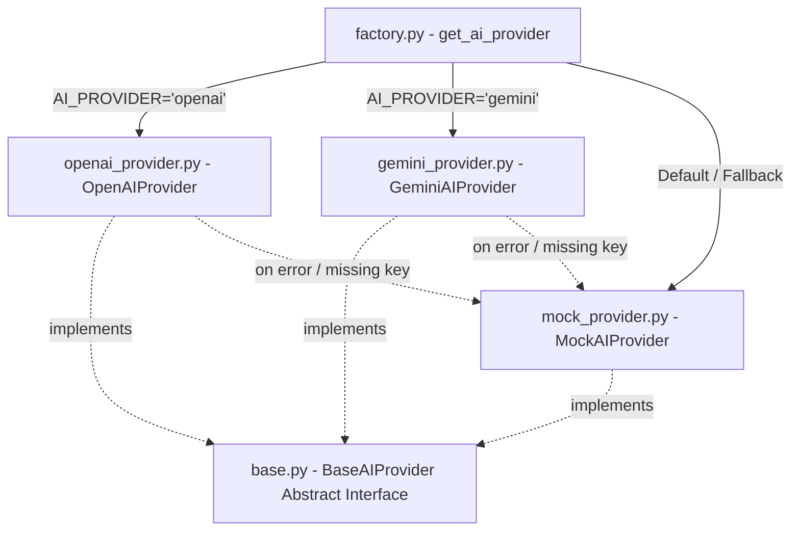
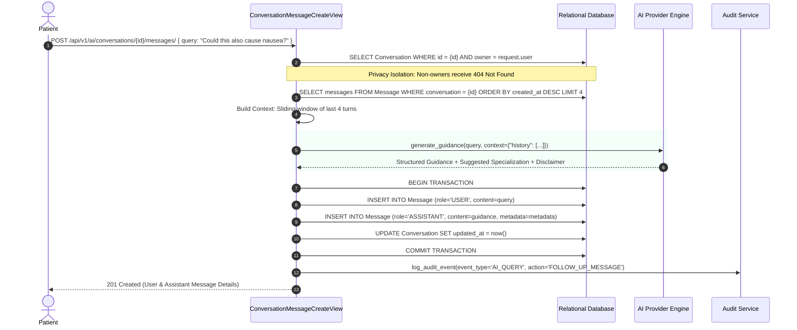

# VakCare — AI Healthcare Assistant Architecture & Safety Boundaries

## 1. Overview & Objectives

The VakCare AI Healthcare Assistant is an intelligent triage and medical education subsystem designed to assist patients in understanding their symptoms, exploring general wellness advice, and identifying suitable medical specialists.

### Core Objectives
1. **Clinical Triage & Specialist Recommendations**: Directs patients with specific symptoms (e.g., chest pain, palpitations, skin rashes) to the appropriate medical doctor specialization on the platform (e.g., `CARDIOLOGY`, `DERMATOLOGY`, `GENERAL_MEDICINE`).
2. **Medical Safety Guardrails**: Ensures the AI never attempts definitive clinical diagnoses or drug prescriptions.
3. **Emergency Escalation**: Detects life-threatening symptoms and triggers urgent emergency advisories.
4. **Clinical Record Summarization**: Converts complex doctor consultation notes and laboratory metrics into plain, patient-accessible terms.
5. **Multi-Turn Persistent Sessions**: Manages conversational threads with short-term contextual memory.
6. **Zero-Vendor-Lockin Pluggability**: Decoupled design allowing seamless transitions between **OpenAI**, **Google Gemini**, and offline **Deterministic Mock** providers.

---

## 2. Pluggable Architecture (Factory Pattern)

The AI module uses a **Factory Pattern** (`backend/apps/ai_assistant/providers/factory.py`) to instantiate the appropriate provider based on the environment configuration `AI_PROVIDER`:



### Provider Matrix

| Provider | Environment Value | Target Models | Behavior on Network / Key Error |
| :--- | :---: | :---: | :--- |
| **OpenAI** | `openai` or `chatgpt` | `gpt-4o-mini`, `gpt-4o`, `gpt-3.5-turbo` | Falls back gracefully to `MockAIProvider` |
| **Google Gemini** | `gemini` or `google` | `gemini-2.5-flash`, `gemini-1.5-pro` | Falls back gracefully to `MockAIProvider` |
| **Mock Provider** | `mock` (Default) | Deterministic Rules Engine | Standalone, zero external dependencies |

---

## 3. Medical Safety Guardrails & Triage Rules

### 3.1 Mandatory Clinical Disclaimer
Every response generated across all providers includes a strict, non-negotiable medical disclaimer:

> **DISCLAIMER**: This guidance is generated by an automated AI assistant for educational and informational purposes only. It does NOT constitute a confirmed medical diagnosis, clinical prescription, or emergency medical advice. Always consult a licensed healthcare professional or visit the nearest emergency facility for critical or urgent symptoms.

### 3.2 Clinical Boundary Prompt Engineering
All external LLM prompts enforce the following system rules:
```text
You are a medical healthcare AI triage assistant on the VakCare platform.
Guidelines:
1. You must NEVER provide a definitive clinical diagnosis or prescribe prescription drugs.
2. Offer helpful health education, self-care measures, and lifestyle guidance.
3. Identify the most suitable medical doctor specialization (e.g. GENERAL_MEDICINE, CARDIOLOGY, DERMATOLOGY, PEDIATRICS).
4. If symptoms sound severe or life-threatening (e.g. chest pain, shortness of breath, sudden weakness), immediately advise emergency care.
5. Always append the required clinical disclaimer.
```

### 3.3 Emergency Escalation Logic
When user inquiries contain indicators of life-threatening emergencies (e.g. crushing chest pain, radiating pain to jaw/arm, shortness of breath, symptoms of stroke):
- The AI immediately advises calling local emergency services (112 / 911).
- The response metadata sets `"is_emergency_alert": true`.
- The frontend renders an emergency warning banner directing the user to urgent care.

---

## 4. Multi-Turn Conversational Memory Model

Conversational AI inquiries are stored in dedicated database tables (`Conversation` and `Message` in `apps.ai_assistant`):



### Privacy & Data Isolation
- Conversations belong strictly to `request.user`.
- Neither healthcare professionals nor platform administrators have access to a patient's personal AI chat transcripts.
- Any attempt to access a conversation owned by another user yields a `404 Not Found` (to avoid ID enumeration).

---

## 5. Medical Record Summarization (`/api/v1/ai/summarize-record/`)

Patients frequently struggle to understand dense medical jargon in laboratory reports and diagnostic summaries. VakCare provides an automated record summarizer:

### Authorization Matrix
The endpoint requires that the requesting user is:
1. The patient who owns the medical record; **OR**
2. The healthcare professional who authored the record; **OR**
3. A platform administrator.

### Summarization Output Format
```json
{
  "status": "success",
  "data": {
    "provider": "MockAIProvider (Deterministic)",
    "summary": "Plain-language patient summary:\n- Medical Record Title: Cardiology Consultation Note\n- Clinical Summary: Resting vitals and cardiac assessment are within stable parameters.\n- Recommended Action: Adhere to doctor-prescribed medication and schedule recommended follow-up tests.",
    "key_takeaways": [
      "Follow doctor's direct clinical recommendations",
      "Attend scheduled follow-up consultations",
      "Reach out to your clinic immediately if symptoms worsen"
    ],
    "disclaimer": "DISCLAIMER: This guidance is generated by an automated AI assistant..."
  }
}
```
