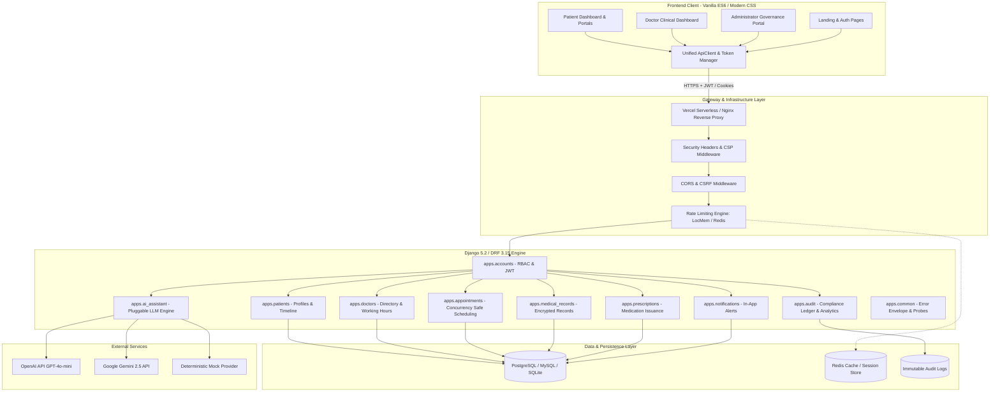
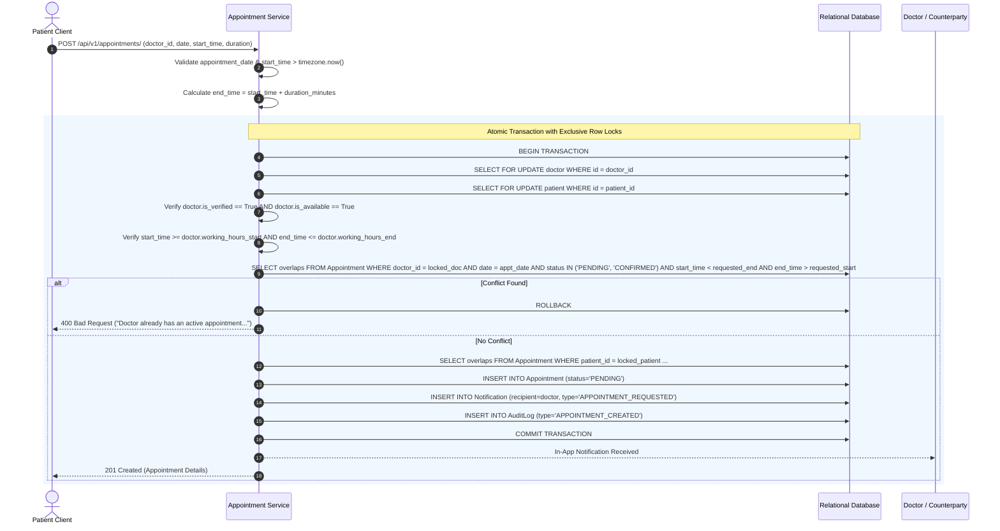
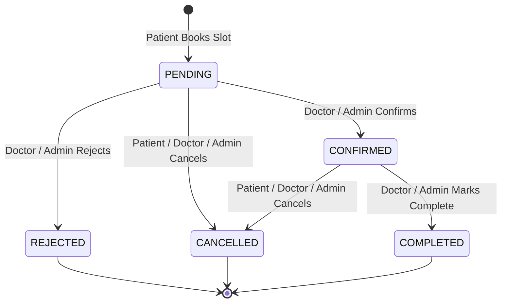
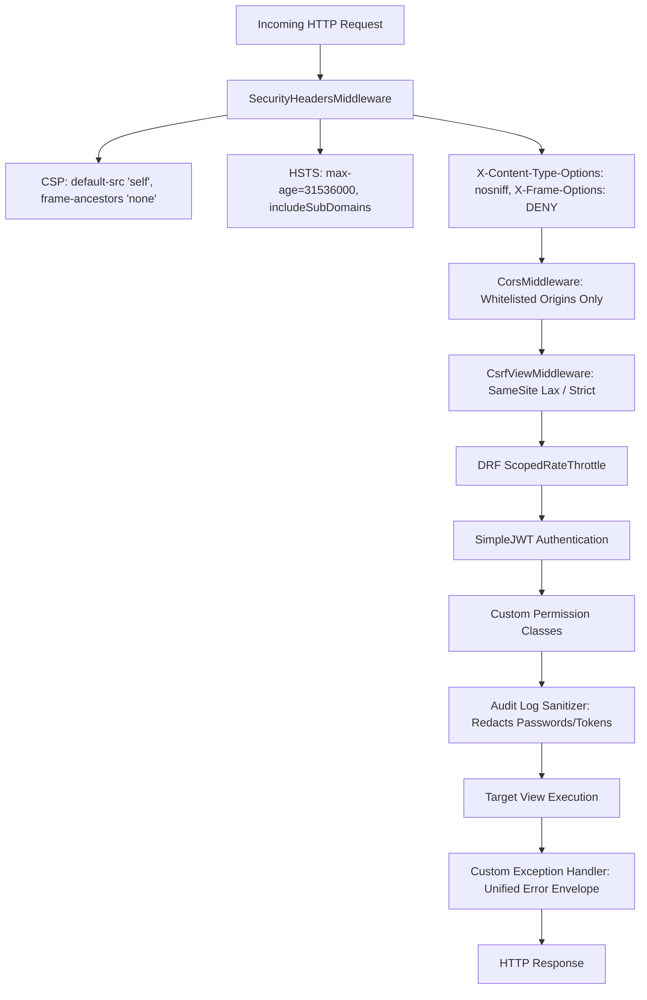

# VakCare — System Architecture & Design Specification

## 1. Architectural Overview

VakCare is an enterprise-grade, full-stack healthcare management platform engineered with a strict separation of concerns, defense-in-depth security principles, and domain-driven design. The platform connects three primary stakeholders: **Patients**, **Verified Healthcare Practitioners (Doctors)**, and **Platform Administrators**.



---

## 2. Core Architectural Pillars

### 2.1 Domain-Driven Partitioning (Django Apps)
The backend is structured into 10 decoupled domain applications located under `backend/apps/`:

| Domain Application | Primary Responsibility | Key Entities & Services |
| :--- | :--- | :--- |
| **`apps.accounts`** | Authentication, JWT token lifecycle, custom User model, RBAC | `User`, `UserManager`, `set_refresh_cookie`, `CookieTokenRefreshView` |
| **`apps.patients`** | Demographics, emergency contacts, unified health timeline | `PatientProfile`, `PatientHealthTimelineView`, `PatientClinicalHistoryView` |
| **`apps.doctors`** | Practitioner directory, search, schedule boundaries, credential verification | `DoctorProfile`, `DoctorListView`, `DoctorVerifyView` |
| **`apps.appointments`** | Race-condition-free slot booking, consultation state machine | `Appointment`, `create_appointment`, `confirm_appointment`, `DoctorDailyScheduleView` |
| **`apps.medical_records`**| Audited Electronic Health Records (EHR) & diagnostic notes | `MedicalRecord`, `MedicalRecordListCreateView` |
| **`apps.prescriptions`** | Prescription issuance, structured medication items, dosage schedules | `Prescription`, `PrescriptionItem`, `PrescriptionCreateSerializer` |
| **`apps.notifications`** | In-app alerts, read state, automated appointment reminders | `Notification`, `send_notification`, `generate_appointment_reminders` |
| **`apps.ai_assistant`** | Pluggable LLM integration, medical triage, records summarization | `Conversation`, `Message`, `OpenAIProvider`, `GeminiAIProvider`, `MockAIProvider` |
| **`apps.audit`** | Security audit ledger, sanitized event recording, administrative KPI analytics | `AuditLog`, `log_audit_event`, `sanitize_details`, `AdminAnalyticsView` |
| **`apps.common`** | Timestamped abstract base models, unified error envelopes, liveness/readiness | `TimeStampedModel`, `custom_exception_handler`, `SecurityHeadersMiddleware` |

---

## 3. Concurrency Control & Double-Booking Prevention

In healthcare platforms, slot double-booking introduces severe clinical conflicts. VakCare solves this at the database level using pessimistic row locking within an isolated atomic transaction:



### Key Concurrency Invariants
1. **Pessimistic Locking (`select_for_update`)**: Concurrently executing requests trying to reserve slots with the same doctor or patient block until the prior transaction commits or rolls back.
2. **Boundary Checks**: Working hours are verified strictly against the doctor's stored `working_hours_start` and `working_hours_end`.
3. **Past-Date Rejection**: Timezone-aware validation ensures appointments cannot be scheduled in the past.
4. **Active Status Filter**: Only appointments with `status IN ('PENDING', 'CONFIRMED')` occupy time slots. `CANCELLED` and `REJECTED` appointments release slots immediately.

---

## 4. Role-Based Access Control (RBAC) & State Machine

### 4.1 Role Matrix
VakCare implements strict role isolation across three user personas:

| Capability / Resource | Patient | Doctor | Administrator |
| :--- | :---: | :---: | :---: |
| Self-Registration & Profile Update | Yes | Admin Provisioned | CLI / Seeded |
| Public Doctor Directory Search | Yes | Yes | Yes |
| Request Appointment Slot | Yes | No | Yes (on behalf) |
| Confirm / Reject Appointment | No | Yes (assigned only) | Yes |
| Complete Consultation | No | Yes (assigned only) | Yes |
| Cancel Appointment | Yes (own) | Yes (assigned) | Yes (any) |
| Read Medical Records | Yes (own only) | Yes (consulted patients) | Yes (all) |
| Create Medical Record | No | Yes (verified only) | Yes |
| Issue Prescriptions | No | Yes (verified only) | No |
| Access AI Health Assistant | Yes (isolated) | Yes (isolated) | Yes (isolated) |
| View Security Audit Logs | No | No | Yes |
| Doctor Verification Approval | No | No | Yes |
| Platform Analytics Dashboard | No | No | Yes |

### 4.2 Appointment Lifecycle State Machine



---

## 5. Security & Defense-in-Depth Architecture



1. **Token Security**:
   - Access tokens have a short lifetime (30 minutes).
   - Refresh tokens (7 days) are rotated upon each use (`ROTATE_REFRESH_TOKENS = True`) and blacklisted in the database (`BLACKLIST_AFTER_ROTATION = True`).
   - Refresh tokens can be delivered via JSON body or stored in an `HttpOnly`, `Secure`, `SameSite=Lax` cookie (`vakcare_refresh_token`).
2. **Immutable Audit Trail**:
   - Sensitive user operations (logins, logouts, appointments, prescriptions, clinical notes, AI inquiries, administrative verifications) are recorded in the `AuditLog` table.
   - All payloads pass through `sanitize_details()` to ensure credentials, secrets, and authorization tokens are redacted (`[REDACTED]`).
3. **Protected Health Information (PHI) Privacy**:
   - A doctor cannot access patient clinical records unless an active or historical appointment relationship exists between them.
   - Unauthorized attempts immediately trigger a `PERMISSION_DENIED` security audit event.

---

## 6. Unified JSON Error Envelope

Every API error returns a standardized envelope format ensuring client-side resilience:

```json
{
  "status": "error",
  "error": {
    "code": "VALIDATION_ERROR | AUTHENTICATION_FAILED | PERMISSION_DENIED | RESOURCE_NOT_FOUND | CONFLICT | RATE_LIMIT_EXCEEDED | INTERNAL_SERVER_ERROR",
    "message": "Human-readable diagnostic summary",
    "details": {
      "field_name": ["Specific validation error message"]
    }
  }
}
```
