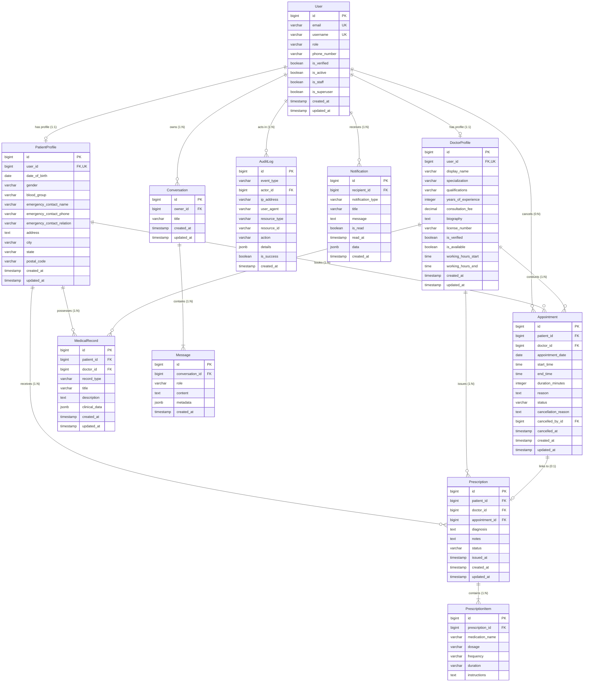

# VakCare — Database Schema & Data Model Specification

## 1. Entity-Relationship (ER) Diagram

---

## 2. Table-by-Table Schema Definitions

### 2.1 `accounts_user`
Custom User model derived from Django's `AbstractUser`, storing platform credentials and application roles.
- **Indexes**:
  - `idx_user_email_role` on `(email, role)`
  - Unique on `email`
  - Unique on `username`

| Column | Type | Constraints | Description |
| :--- | :--- | :--- | :--- |
| `id` | `BIGINT` | PRIMARY KEY, AUTO_INCREMENT | Unique user identifier |
| `email` | `VARCHAR(254)` | UNIQUE, NOT NULL, INDEX | Primary email for login and alerts |
| `username` | `VARCHAR(150)` | UNIQUE, NOT NULL | Account handle |
| `password` | `VARCHAR(128)` | NOT NULL | Salted PBKDF2/Argon2 password hash |
| `role` | `VARCHAR(20)` | NOT NULL, DEFAULT `'PATIENT'` | `PATIENT`, `DOCTOR`, or `ADMIN` |
| `phone_number` | `VARCHAR(20)` | NULLABLE, DEFAULT `''` | Contact telephone number |
| `is_verified` | `BOOLEAN` | NOT NULL, DEFAULT `FALSE` | Role/license verification flag |
| `is_active` | `BOOLEAN` | NOT NULL, DEFAULT `TRUE` | Soft-deletion / active account flag |
| `is_staff` | `BOOLEAN` | NOT NULL, DEFAULT `FALSE` | Django admin panel access flag |
| `is_superuser` | `BOOLEAN` | NOT NULL, DEFAULT `FALSE` | Superuser flag |
| `created_at` | `TIMESTAMP` | NOT NULL, AUTO_NOW_ADD | Creation timestamp |
| `updated_at` | `TIMESTAMP` | NOT NULL, AUTO_NOW | Last profile update timestamp |

---

### 2.2 `patients_patientprofile`
Demographic and emergency contact details for registered patients.
- **Indexes**:
  - `idx_patient_user` on `(user_id)`

| Column | Type | Constraints | Description |
| :--- | :--- | :--- | :--- |
| `id` | `BIGINT` | PRIMARY KEY, AUTO_INCREMENT | Profile identifier |
| `user_id` | `BIGINT` | ONE-TO-ONE, FK(`accounts_user.id`), CASCADE | Linked user account |
| `date_of_birth` | `DATE` | NULLABLE | Patient birth date |
| `gender` | `VARCHAR(20)` | NOT NULL | `MALE`, `FEMALE`, `OTHER`, `PREFER_NOT_TO_SAY` |
| `blood_group` | `VARCHAR(10)` | NOT NULL | `A+`, `A-`, `B+`, `B-`, `AB+`, `AB-`, `O+`, `O-`, `UNKNOWN` |
| `emergency_contact_name` | `VARCHAR(150)` | DEFAULT `''` | Emergency contact full name |
| `emergency_contact_phone` | `VARCHAR(20)` | DEFAULT `''` | Emergency phone number |
| `emergency_contact_relation`| `VARCHAR(50)` | DEFAULT `''` | Relation to patient (e.g. Spouse, Parent) |
| `address` | `TEXT` | DEFAULT `''` | Residential address |
| `city` | `VARCHAR(100)` | DEFAULT `''` | City |
| `state` | `VARCHAR(100)` | DEFAULT `''` | State / Province |
| `postal_code` | `VARCHAR(20)` | DEFAULT `''` | Postal / Zip code |
| `created_at` | `TIMESTAMP` | NOT NULL, AUTO_NOW_ADD | Creation timestamp |
| `updated_at` | `TIMESTAMP` | NOT NULL, AUTO_NOW | Last modified timestamp |

---

### 2.3 `doctors_doctorprofile`
Licensed healthcare provider profile managing medical qualifications, availability, and working hours.
- **Indexes**:
  - `idx_doctor_spec_verif_avail` on `(specialization, is_verified, is_available)`

| Column | Type | Constraints | Description |
| :--- | :--- | :--- | :--- |
| `id` | `BIGINT` | PRIMARY KEY, AUTO_INCREMENT | Profile identifier |
| `user_id` | `BIGINT` | ONE-TO-ONE, FK(`accounts_user.id`), CASCADE | Linked doctor user account |
| `display_name` | `VARCHAR(150)` | NOT NULL | Formatted professional name |
| `specialization` | `VARCHAR(50)` | NOT NULL, INDEX | Specialization enum (e.g. `CARDIOLOGY`) |
| `qualifications` | `VARCHAR(255)` | NOT NULL | Degrees (e.g., MBBS, MD, MS) |
| `years_of_experience` | `INTEGER` | NOT NULL, MIN(0) | Years in clinical practice |
| `consultation_fee` | `DECIMAL(10,2)`| NOT NULL, MIN(0.00) | Standard consultation fee |
| `biography` | `TEXT` | DEFAULT `''` | Professional background and summary |
| `license_number` | `VARCHAR(100)`| DEFAULT `''` | State medical registration number |
| `is_verified` | `BOOLEAN` | NOT NULL, DEFAULT `FALSE`, INDEX | Admin credential verification status |
| `is_available` | `BOOLEAN` | NOT NULL, DEFAULT `TRUE`, INDEX | Doctor accepting appointments flag |
| `working_hours_start` | `TIME` | NOT NULL, DEFAULT `'09:00:00'` | Daily shift start time |
| `working_hours_end` | `TIME` | NOT NULL, DEFAULT `'17:00:00'` | Daily shift end time |
| `created_at` | `TIMESTAMP` | NOT NULL, AUTO_NOW_ADD | Registration timestamp |
| `updated_at` | `TIMESTAMP` | NOT NULL, AUTO_NOW | Last update timestamp |

---

### 2.4 `appointments_appointment`
Consultation appointments between patients and doctors with concurrency controls.
- **Indexes**:
  - `idx_appt_doc_date_status` on `(doctor_id, appointment_date, status)`
  - `idx_appt_pat_date_status` on `(patient_id, appointment_date, status)`
  - `idx_appt_status_date` on `(status, appointment_date)`

| Column | Type | Constraints | Description |
| :--- | :--- | :--- | :--- |
| `id` | `BIGINT` | PRIMARY KEY, AUTO_INCREMENT | Appointment ID |
| `patient_id` | `BIGINT` | FK(`patients_patientprofile.id`), PROTECT | Booking patient |
| `doctor_id` | `BIGINT` | FK(`doctors_doctorprofile.id`), PROTECT | Consulting doctor |
| `appointment_date` | `DATE` | NOT NULL, INDEX | Consultation date |
| `start_time` | `TIME` | NOT NULL | Slot start time |
| `end_time` | `TIME` | NOT NULL | Slot end time (`start_time + duration`) |
| `duration_minutes` | `INTEGER` | NOT NULL, DEFAULT 30 | Consultation length in minutes |
| `reason` | `TEXT` | NOT NULL | Primary patient symptoms |
| `status` | `VARCHAR(20)` | NOT NULL, DEFAULT `'PENDING'`, INDEX | `PENDING`, `CONFIRMED`, `REJECTED`, `CANCELLED`, `COMPLETED` |
| `cancellation_reason` | `TEXT` | DEFAULT `''` | Explanation if rejected/cancelled |
| `cancelled_by_id` | `BIGINT` | NULLABLE, FK(`accounts_user.id`), SET_NULL | User who cancelled/rejected |
| `cancelled_at` | `TIMESTAMP` | NULLABLE | Timestamp of cancellation |
| `created_at` | `TIMESTAMP` | NOT NULL, AUTO_NOW_ADD | Booking timestamp |
| `updated_at` | `TIMESTAMP` | NOT NULL, AUTO_NOW | State change timestamp |

---

### 2.5 `medical_records_medicalrecord`
Electronic Health Records (EHR) preserving clinical findings, vitals, and diagnostics.
- **Indexes**:
  - `idx_medrec_pat_type_created` on `(patient_id, record_type, created_at)`

| Column | Type | Constraints | Description |
| :--- | :--- | :--- | :--- |
| `id` | `BIGINT` | PRIMARY KEY, AUTO_INCREMENT | Record identifier |
| `patient_id` | `BIGINT` | FK(`patients_patientprofile.id`), CASCADE | Patient owner |
| `doctor_id` | `BIGINT` | NULLABLE, FK(`doctors_doctorprofile.id`), SET_NULL | Authoring doctor |
| `record_type` | `VARCHAR(50)` | NOT NULL, INDEX | `CONSULTATION_NOTE`, `DIAGNOSIS`, `LAB_RESULT`, `DISCHARGE_SUMMARY`, `VACCINATION`, `OTHER` |
| `title` | `VARCHAR(255)` | NOT NULL | Record headline |
| `description` | `TEXT` | NOT NULL | Detailed clinical findings |
| `clinical_data` | `JSON/JSONB` | NOT NULL, DEFAULT `{}` | Structured vitals / laboratory metrics |
| `created_at` | `TIMESTAMP` | NOT NULL, AUTO_NOW_ADD | Clinical record timestamp |
| `updated_at` | `TIMESTAMP` | NOT NULL, AUTO_NOW | Update timestamp |

---

### 2.6 `prescriptions_prescription` & `prescriptions_prescriptionitem`
Prescription orders issued by verified medical professionals.
- **Indexes**:
  - `idx_rx_pat_status_issued` on `(patient_id, status, issued_at)`
  - `idx_rx_doc_issued` on `(doctor_id, issued_at)`

#### `prescriptions_prescription`
| Column | Type | Constraints | Description |
| :--- | :--- | :--- | :--- |
| `id` | `BIGINT` | PRIMARY KEY, AUTO_INCREMENT | Prescription identifier |
| `patient_id` | `BIGINT` | FK(`patients_patientprofile.id`), PROTECT | Target patient |
| `doctor_id` | `BIGINT` | FK(`doctors_doctorprofile.id`), PROTECT | Prescribing doctor |
| `appointment_id` | `BIGINT` | NULLABLE, FK(`appointments_appointment.id`), SET_NULL | Linked consultation |
| `diagnosis` | `TEXT` | NOT NULL | Clinical condition diagnosis |
| `notes` | `TEXT` | DEFAULT `''` | Dietary instructions / precautions |
| `status` | `VARCHAR(20)` | NOT NULL, DEFAULT `'ACTIVE'`, INDEX | `ACTIVE`, `COMPLETED`, `CANCELLED` |
| `issued_at` | `TIMESTAMP` | NOT NULL, AUTO_NOW_ADD | Issuance timestamp |

#### `prescriptions_prescriptionitem`
| Column | Type | Constraints | Description |
| :--- | :--- | :--- | :--- |
| `id` | `BIGINT` | PRIMARY KEY, AUTO_INCREMENT | Item identifier |
| `prescription_id` | `BIGINT` | FK(`prescriptions_prescription.id`), CASCADE | Parent prescription |
| `medication_name` | `VARCHAR(255)`| NOT NULL | Medication or drug title |
| `dosage` | `VARCHAR(100)`| NOT NULL | Dosage (e.g., 500mg, 10ml) |
| `frequency` | `VARCHAR(100)`| NOT NULL | Schedule (e.g., Twice daily after food) |
| `duration` | `VARCHAR(100)`| NOT NULL | Course duration (e.g., 5 days, 1 month) |
| `instructions` | `TEXT` | DEFAULT `''` | Specific administration instructions |

---

### 2.7 `notifications_notification`
In-app notification ledger for event alerts and appointment reminders.
- **Indexes**:
  - `idx_notif_recipient_read_created` on `(recipient_id, is_read, created_at)`

| Column | Type | Constraints | Description |
| :--- | :--- | :--- | :--- |
| `id` | `BIGINT` | PRIMARY KEY, AUTO_INCREMENT | Notification ID |
| `recipient_id` | `BIGINT` | FK(`accounts_user.id`), CASCADE | Target user |
| `notification_type` | `VARCHAR(50)` | NOT NULL, INDEX | Notification enum (e.g. `APPOINTMENT_CONFIRMED`) |
| `title` | `VARCHAR(255)` | NOT NULL | Notification title |
| `message` | `TEXT` | NOT NULL | Descriptive message |
| `is_read` | `BOOLEAN` | NOT NULL, DEFAULT `FALSE`, INDEX | Read status |
| `read_at` | `TIMESTAMP` | NULLABLE | Timestamp when read |
| `data` | `JSON/JSONB` | NOT NULL, DEFAULT `{}` | Navigation metadata (e.g. `appointment_id`) |
| `created_at` | `TIMESTAMP` | NOT NULL, AUTO_NOW_ADD | Created timestamp |

---

### 2.8 `ai_assistant_conversation` & `ai_assistant_message`
Persistent conversational AI inquiry sessions and message turns.
- **Indexes**:
  - `idx_ai_conv_owner_updated` on `(owner_id, updated_at)`
  - `idx_ai_msg_conv_created` on `(conversation_id, created_at)`

#### `ai_assistant_conversation`
| Column | Type | Constraints | Description |
| :--- | :--- | :--- | :--- |
| `id` | `BIGINT` | PRIMARY KEY, AUTO_INCREMENT | Conversation ID |
| `owner_id` | `BIGINT` | FK(`accounts_user.id`), CASCADE | Owning user |
| `title` | `VARCHAR(255)` | NOT NULL, DEFAULT `'General Health Inquiry'` | Conversation title |
| `created_at` | `TIMESTAMP` | NOT NULL, AUTO_NOW_ADD | Session start timestamp |
| `updated_at` | `TIMESTAMP` | NOT NULL, AUTO_NOW | Last message timestamp |

#### `ai_assistant_message`
| Column | Type | Constraints | Description |
| :--- | :--- | :--- | :--- |
| `id` | `BIGINT` | PRIMARY KEY, AUTO_INCREMENT | Message ID |
| `conversation_id` | `BIGINT` | FK(`ai_assistant_conversation.id`), CASCADE | Parent conversation |
| `role` | `VARCHAR(20)` | NOT NULL, INDEX | `USER` or `ASSISTANT` |
| `content` | `TEXT` | NOT NULL | Message text |
| `metadata` | `JSON/JSONB` | NOT NULL, DEFAULT `{}` | Provider, disclaimer, suggested spec |
| `created_at` | `TIMESTAMP` | NOT NULL, AUTO_NOW_ADD | Turn timestamp |

---

### 2.9 `audit_auditlog`
Immutable security and HIPAA-aligned compliance audit ledger.
- **Indexes**:
  - `idx_audit_event_created` on `(event_type, created_at)`
  - `idx_audit_actor_created` on `(actor_id, created_at)`
  - `idx_audit_resource` on `(resource_type, resource_id)`

| Column | Type | Constraints | Description |
| :--- | :--- | :--- | :--- |
| `id` | `BIGINT` | PRIMARY KEY, AUTO_INCREMENT | Log ID |
| `event_type` | `VARCHAR(50)` | NOT NULL, INDEX | Security event type (e.g., `AUTH_LOGIN`, `APPOINTMENT_CREATED`) |
| `actor_id` | `BIGINT` | NULLABLE, FK(`accounts_user.id`), SET_NULL | Acting user (NULL for unauthenticated) |
| `ip_address` | `INET / VARCHAR(45)` | NULLABLE | Client remote IP address |
| `user_agent` | `VARCHAR(255)` | DEFAULT `''` | HTTP User Agent header |
| `resource_type`| `VARCHAR(100)`| DEFAULT `''` | Resource entity (e.g. `Appointment`, `DoctorProfile`) |
| `resource_id` | `VARCHAR(100)`| DEFAULT `''` | ID of modified resource |
| `action` | `VARCHAR(100)`| NOT NULL | Executed action string |
| `details` | `JSON/JSONB` | NOT NULL, DEFAULT `{}` | Sanitized parameter payload |
| `is_success` | `BOOLEAN` | NOT NULL, DEFAULT `TRUE` | Success / Failure flag |
| `created_at` | `TIMESTAMP` | NOT NULL, AUTO_NOW_ADD | Immutable event timestamp |
