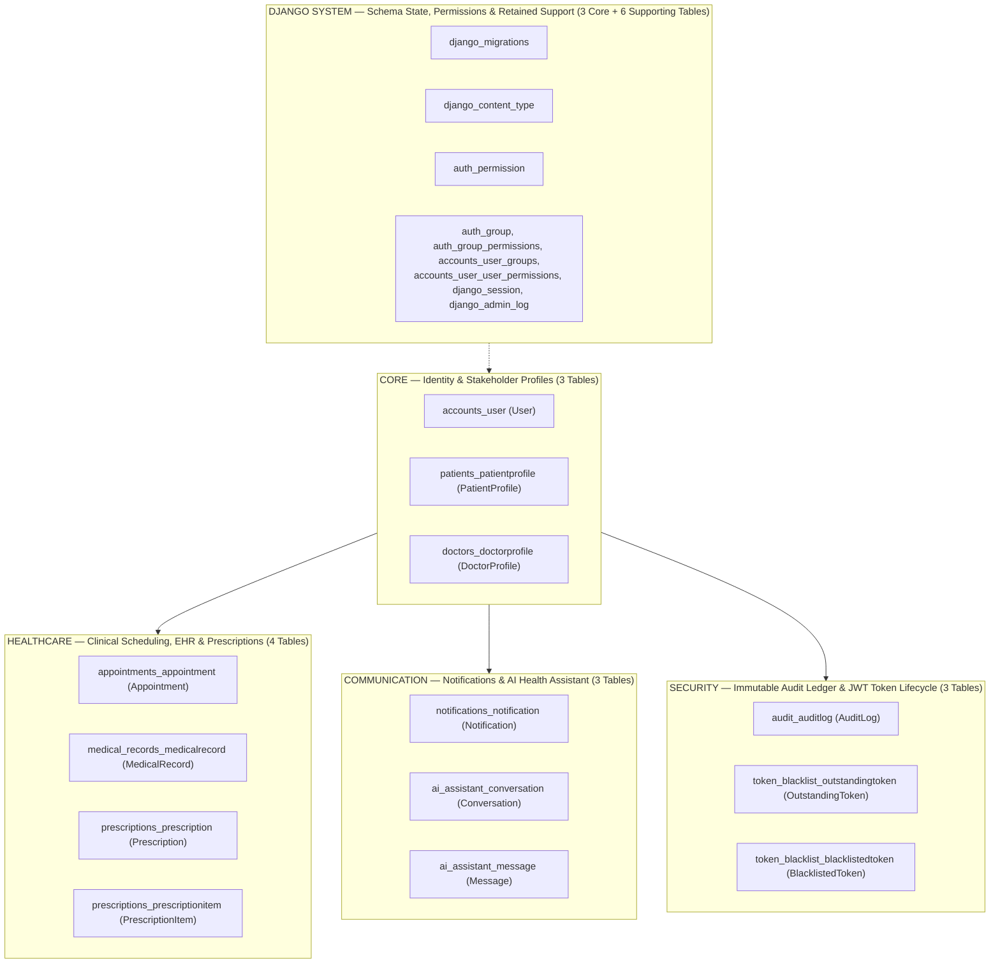
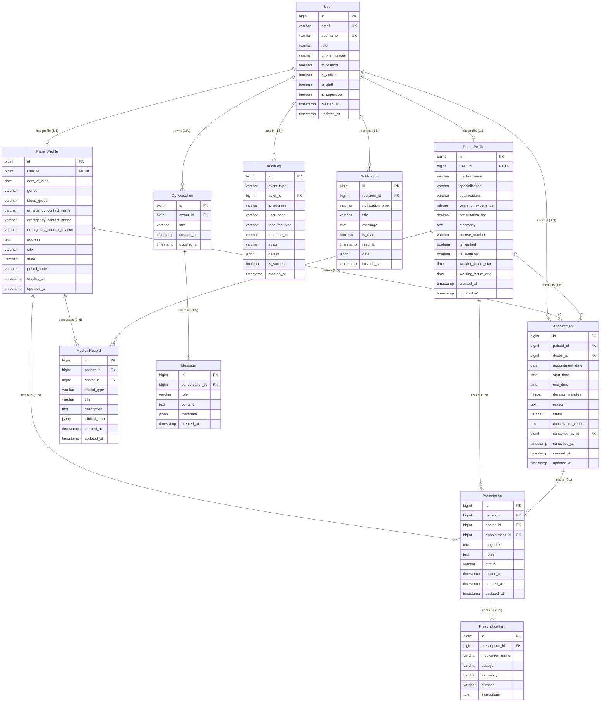

# VakCare — Database Schema & Data Model Specification

> For environment configuration (`local` vs. `aiven`), safety guards, backup, and restore workflows, see **[Deployment & Operations Manual](DEPLOYMENT_AND_OPERATIONS.md#4-database-environments-migrations-backup--restore)**.

## 1. 5-Tier Logical Database Architecture

VakCare persists platform state in a synchronized InnoDB MySQL schema (and supports SQLite for isolated automated testing). Because MySQL tables share a flat schema namespace and Django maps models to `<app_label>_<model_name>`, VakCare organizes its **22 tables** (and **84 non-redundant indexes**, **26 enforced InnoDB foreign keys**, **3 check constraints**) into a **5-tier logical grouping** reflected across `backend/config/settings/base.py`, Django `AppConfig` classes, and Django Admin registrations:

### 1.1 Logical Categories & Shared Conventions

| Logical Category | Purpose | Tables | Django Apps / Packages |
| :--- | :--- | :--- | :--- |
| **CORE** | Auth identity, RBAC roles (`PATIENT`, `DOCTOR`, `ADMIN`), patient demographics, verified practitioner directory | `accounts_user`, `patients_patientprofile`, `doctors_doctorprofile` | `apps.accounts`, `apps.patients`, `apps.doctors` |
| **HEALTHCARE** | Atomic slot scheduling (`select_for_update`), EHR notes/vitals, multi-item medication prescriptions | `appointments_appointment`, `medical_records_medicalrecord`, `prescriptions_prescription`, `prescriptions_prescriptionitem` | `apps.appointments`, `apps.medical_records`, `apps.prescriptions` |
| **COMMUNICATION** | In-app notifications/reminders and owner-isolated multi-turn AI health conversations | `notifications_notification`, `ai_assistant_conversation`, `ai_assistant_message` | `apps.notifications`, `apps.ai_assistant` |
| **SECURITY** | Sanitized, append-only compliance audit trail and rotated/revoked JWT refresh token tracking | `audit_auditlog`, `token_blacklist_outstandingtoken`, `token_blacklist_blacklistedtoken` | `apps.audit`, `rest_framework_simplejwt.token_blacklist` |
| **DJANGO SYSTEM** | Migration history, content types, permissions, Django Admin log, session store, group/permission M2M links | Core: `django_migrations`, `django_content_type`, `auth_permission` Supporting: `auth_group`, `auth_group_permissions`, `accounts_user_groups`, `accounts_user_user_permissions`, `django_session`, `django_admin_log` | `django.contrib.admin`, `django.contrib.auth`, `django.contrib.contenttypes`, `django.contrib.sessions` |

- **Abstract Base Model (`apps.common.models.TimeStampedModel`)**: Supplies `created_at` (`datetime(6)`, indexed), `updated_at` (`datetime(6)`), and soft-active `is_active` (`tinyint(1)`, indexed) to `PatientProfile`, `DoctorProfile`, `Appointment`, `MedicalRecord`, `Prescription`, and `Conversation`. `apps.common` defines no concrete database tables.
- **Primary Keys & Deterministic Ordering**: All 11 domain models and `token_blacklist_*` tables use 64-bit `BIGINT AUTO_INCREMENT` (`BigAutoField`), and all domain models declare explicit `Meta.ordering` so DRF pagination never emits `UnorderedObjectListWarning`.
- **Concurrency & Lock Safety**: Appointment booking runs inside `transaction.atomic()` with `select_for_update()` on `DoctorProfile` and `PatientProfile` to eliminate slot double-booking races.
- **Retained Django Supporting Tables**: `auth_group`, `auth_group_permissions`, `accounts_user_groups`, `accounts_user_user_permissions`, `django_session`, and `django_admin_log` are intentionally kept because `django.contrib.auth` (`PermissionsMixin`), `SessionMiddleware`, and `/admin/` (`AuditLogAdmin` and domain admins) depend on them.

---

## 2. Entity-Relationship (ER) Diagram

---

## 3. Master Table & Index Inventory (22 Tables, 84 Indexes)

| # | MySQL Table Name | Logical Category | Django App | Model Class / Role | Admin Class | PK Type |
| :---: | :--- | :--- | :--- | :--- | :--- | :--- |
| 1 | `accounts_user` | **CORE** | `accounts` | `apps.accounts.models.User` | `UserAdmin` | `bigint` |
| 2 | `patients_patientprofile` | **CORE** | `patients` | `apps.patients.models.PatientProfile` | `PatientProfileAdmin` | `bigint` |
| 3 | `doctors_doctorprofile` | **CORE** | `doctors` | `apps.doctors.models.DoctorProfile` | `DoctorProfileAdmin` | `bigint` |
| 4 | `appointments_appointment` | **HEALTHCARE** | `appointments` | `apps.appointments.models.Appointment` | `AppointmentAdmin` | `bigint` |
| 5 | `medical_records_medicalrecord` | **HEALTHCARE** | `medical_records` | `apps.medical_records.models.MedicalRecord` | `MedicalRecordAdmin` | `bigint` |
| 6 | `prescriptions_prescription` | **HEALTHCARE** | `prescriptions` | `apps.prescriptions.models.Prescription` | `PrescriptionAdmin` | `bigint` |
| 7 | `prescriptions_prescriptionitem` | **HEALTHCARE** | `prescriptions` | `apps.prescriptions.models.PrescriptionItem` | `PrescriptionItemAdmin` | `bigint` |
| 8 | `notifications_notification` | **COMMUNICATION** | `notifications` | `apps.notifications.models.Notification` | `NotificationAdmin` | `bigint` |
| 9 | `ai_assistant_conversation` | **COMMUNICATION** | `ai_assistant` | `apps.ai_assistant.models.Conversation` | `ConversationAdmin` | `bigint` |
| 10 | `ai_assistant_message` | **COMMUNICATION** | `ai_assistant` | `apps.ai_assistant.models.Message` | `MessageAdmin` | `bigint` |
| 11 | `audit_auditlog` | **SECURITY** | `audit` | `apps.audit.models.AuditLog` | `AuditLogAdmin` (Read-Only) | `bigint` |
| 12 | `token_blacklist_outstandingtoken` | **SECURITY** | `token_blacklist` | `OutstandingToken` (SimpleJWT) | SimpleJWT Admin | `bigint` |
| 13 | `token_blacklist_blacklistedtoken` | **SECURITY** | `token_blacklist` | `BlacklistedToken` (SimpleJWT) | SimpleJWT Admin | `bigint` |
| 14 | `django_migrations` | **DJANGO SYSTEM** | `migrations` | Django migration ledger | Internal | `bigint` |
| 15 | `django_content_type` | **DJANGO SYSTEM** | `contenttypes` | `ContentType` | Internal | `int` |
| 16 | `auth_permission` | **DJANGO SYSTEM** | `auth` | `Permission` | Internal | `int` |
| 17 | `auth_group` | **DJANGO SYSTEM** | `auth` | `Group` | `GroupAdmin` | `int` |
| 18 | `auth_group_permissions` | **DJANGO SYSTEM** | `auth` | `Group.permissions` M2M | Inline | `bigint` |
| 19 | `accounts_user_groups` | **DJANGO SYSTEM** | `accounts` | `User.groups` M2M | Inline | `bigint` |
| 20 | `accounts_user_user_permissions` | **DJANGO SYSTEM** | `accounts` | `User.user_permissions` M2M | Inline | `bigint` |
| 21 | `django_session` | **DJANGO SYSTEM** | `sessions` | `Session` | Internal | `varchar(40)` |
| 22 | `django_admin_log` | **DJANGO SYSTEM** | `admin` | `LogEntry` | Internal | `int` |

> **Index Hygiene**: Redundant single-column and duplicate indexes were eliminated via Django migrations (`accounts.0002`, `appointments.0002`, `audit.0003`, `doctors.0002`, `patients.0002`) because leftmost composite prefixes (`(specialization, ...)`, `(status, ...)`, `(event_type, ...)`) and `UNIQUE` constraints (`accounts_user.email`, `patients_patientprofile.user_id`) already cover those lookups, leaving **84 non-redundant indexes**.

---

## 4. Table-by-Table Column Definitions (Local `vakcare_db` & Cloud `defaultdb`)

Both Local MySQL (`8.0`) and Cloud Aiven MySQL (`8.4`) share identical columns, data types, nullability, check constraints (`3`), foreign keys (`26`), and indexes (`84`) across all 22 tables.

### 4.1 `accounts_user` (Logical Category: **CORE**)
Custom User model derived from Django's `AbstractUser`, storing platform credentials and application roles.
- **Indexes & Constraints**:
  - `PRIMARY KEY (id)`
  - `UNIQUE (email)`
  - `UNIQUE (username)`
  - `accounts_user_role_57e97df0` on `(role)`
  - `accounts_user_created_at_04bd66b9` on `(created_at)`

| Column | Type (MySQL) | Constraints | Description |
| :--- | :--- | :--- | :--- |
| `id` | `BIGINT` | PRIMARY KEY, AUTO_INCREMENT | Unique user identifier |
| `email` | `VARCHAR(254)` | UNIQUE, NOT NULL | Primary email for login and alerts |
| `username` | `VARCHAR(150)` | UNIQUE, NOT NULL | Account handle |
| `first_name` | `VARCHAR(150)` | NOT NULL, DEFAULT `''` | First name (`AbstractUser`) |
| `last_name` | `VARCHAR(150)` | NOT NULL, DEFAULT `''` | Last name (`AbstractUser`) |
| `password` | `VARCHAR(128)` | NOT NULL | Salted `pbkdf2_sha256` password hash |
| `role` | `VARCHAR(20)` | NOT NULL, INDEX, DEFAULT `'PATIENT'` | `PATIENT`, `DOCTOR`, or `ADMIN` |
| `phone_number` | `VARCHAR(20)` | NOT NULL, DEFAULT `''` | Contact telephone number |
| `is_verified` | `TINYINT(1)` | NOT NULL, DEFAULT `0` | Role/license verification flag |
| `is_active` | `TINYINT(1)` | NOT NULL, DEFAULT `1` | Active account flag |
| `is_staff` | `TINYINT(1)` | NOT NULL, DEFAULT `0` | Django admin panel access flag |
| `is_superuser` | `TINYINT(1)` | NOT NULL, DEFAULT `0` | Superuser flag |
| `last_login` | `DATETIME(6)` | NULLABLE | Last authentication timestamp |
| `date_joined` | `DATETIME(6)` | NOT NULL | Account join timestamp (`AbstractUser`) |
| `created_at` | `DATETIME(6)` | NOT NULL, INDEX, AUTO_NOW_ADD | Creation timestamp |
| `updated_at` | `DATETIME(6)` | NOT NULL, AUTO_NOW | Last profile update timestamp |

---

### 4.2 `patients_patientprofile` (Logical Category: **CORE**)
Demographic and emergency contact details for registered patients.
- **Indexes & Constraints**:
  - `PRIMARY KEY (id)`
  - `UNIQUE (user_id)` -> `FK(accounts_user.id)` (`CASCADE`)
  - `patients_patientprofile_created_at_caa9549c` on `(created_at)`
  - `patients_patientprofile_is_active_a82835ad` on `(is_active)`

| Column | Type (MySQL) | Constraints | Description |
| :--- | :--- | :--- | :--- |
| `id` | `BIGINT` | PRIMARY KEY, AUTO_INCREMENT | Profile identifier |
| `user_id` | `BIGINT` | ONE-TO-ONE, UNIQUE, FK(`accounts_user.id`), CASCADE | Linked user account |
| `date_of_birth` | `DATE` | NULLABLE | Patient birth date |
| `gender` | `VARCHAR(20)` | NOT NULL | `MALE`, `FEMALE`, `OTHER`, `PREFER_NOT_TO_SAY` |
| `blood_group` | `VARCHAR(10)` | NOT NULL | `A+`, `A-`, `B+`, `B-`, `AB+`, `AB-`, `O+`, `O-`, `UNKNOWN` |
| `emergency_contact_name` | `VARCHAR(150)` | NOT NULL, DEFAULT `''` | Emergency contact full name |
| `emergency_contact_phone` | `VARCHAR(20)` | NOT NULL, DEFAULT `''` | Emergency phone number |
| `emergency_contact_relation`| `VARCHAR(50)` | NOT NULL, DEFAULT `''` | Relation to patient (e.g. Spouse, Parent) |
| `address` | `LONGTEXT` | NOT NULL, DEFAULT `''` | Residential address |
| `city` | `VARCHAR(100)` | NOT NULL, DEFAULT `''` | City |
| `state` | `VARCHAR(100)` | NOT NULL, DEFAULT `''` | State / Province |
| `postal_code` | `VARCHAR(20)` | NOT NULL, DEFAULT `''` | Postal / Zip code |
| `is_active` | `TINYINT(1)` | NOT NULL, INDEX, DEFAULT `1` | Inherited `TimeStampedModel` soft-active flag |
| `created_at` | `DATETIME(6)` | NOT NULL, INDEX, AUTO_NOW_ADD | Creation timestamp |
| `updated_at` | `DATETIME(6)` | NOT NULL, AUTO_NOW | Last modified timestamp |

---

### 4.3 `doctors_doctorprofile` (Logical Category: **CORE**)
Licensed healthcare provider profile managing medical qualifications, availability, and working hours.
- **Indexes & Constraints**:
  - `PRIMARY KEY (id)`
  - `UNIQUE (user_id)` -> `FK(accounts_user.id)` (`CASCADE`)
  - `doctors_doc_special_2a5484_idx` on `(specialization, is_verified, is_available)`
  - `doctors_doctorprofile_is_verified_ee05e73d` on `(is_verified)`
  - `doctors_doctorprofile_is_available_29547c88` on `(is_available)`
  - `doctors_doctorprofile_is_active_d9711f26` on `(is_active)`
  - `doctors_doctorprofile_created_at_aa1f4f85` on `(created_at)`
  - `CHECK (years_of_experience >= 0)` (`doctors_doctorprofile_chk_1`)

| Column | Type (MySQL) | Constraints | Description |
| :--- | :--- | :--- | :--- |
| `id` | `BIGINT` | PRIMARY KEY, AUTO_INCREMENT | Profile identifier |
| `user_id` | `BIGINT` | ONE-TO-ONE, UNIQUE, FK(`accounts_user.id`), CASCADE | Linked doctor user account |
| `display_name` | `VARCHAR(150)` | NOT NULL | Formatted professional name |
| `specialization` | `VARCHAR(50)` | NOT NULL | Specialization enum (covered by composite index) |
| `qualifications` | `VARCHAR(255)` | NOT NULL | Degrees (e.g., MBBS, MD, MS) |
| `years_of_experience` | `INT UNSIGNED` | NOT NULL, CHECK (`>= 0`) | Years in clinical practice |
| `consultation_fee` | `DECIMAL(10,2)`| NOT NULL, MIN(`0.00`) | Standard consultation fee |
| `biography` | `LONGTEXT` | NOT NULL, DEFAULT `''` | Professional background and summary |
| `license_number` | `VARCHAR(100)`| NOT NULL, DEFAULT `''` | State medical registration number |
| `is_verified` | `TINYINT(1)` | NOT NULL, INDEX, DEFAULT `0` | Admin credential verification status |
| `is_available` | `TINYINT(1)` | NOT NULL, INDEX, DEFAULT `1` | Doctor accepting appointments flag |
| `working_hours_start` | `TIME(6)` | NOT NULL, DEFAULT `'09:00:00'` | Daily shift start time |
| `working_hours_end` | `TIME(6)` | NOT NULL, DEFAULT `'17:00:00'` | Daily shift end time |
| `is_active` | `TINYINT(1)` | NOT NULL, INDEX, DEFAULT `1` | Inherited `TimeStampedModel` soft-active flag |
| `created_at` | `DATETIME(6)` | NOT NULL, INDEX, AUTO_NOW_ADD | Registration timestamp |
| `updated_at` | `DATETIME(6)` | NOT NULL, AUTO_NOW | Last update timestamp |

---

### 4.4 `appointments_appointment` (Logical Category: **HEALTHCARE**)
Consultation appointments between patients and doctors with pessimistic locking (`select_for_update`).
- **Indexes & Constraints**:
  - `PRIMARY KEY (id)`
  - `appointment_doctor__f0e3f4_idx` on `(doctor_id, appointment_date, status)`
  - `appointment_patient_90578b_idx` on `(patient_id, appointment_date, status)`
  - `appointment_status_7c15d1_idx` on `(status, appointment_date)`
  - `appointments_appointment_appointment_date_5a0b3382` on `(appointment_date)`
  - `appointments_appointment_created_at_b0ced28d` on `(created_at)`
  - `appointments_appointment_is_active_3ee78205` on `(is_active)`
  - `CHECK (duration_minutes >= 0)` (`appointments_appointment_chk_1`)

| Column | Type (MySQL) | Constraints | Description |
| :--- | :--- | :--- | :--- |
| `id` | `BIGINT` | PRIMARY KEY, AUTO_INCREMENT | Appointment ID |
| `patient_id` | `BIGINT` | NOT NULL, INDEX, FK(`patients_patientprofile.id`), PROTECT | Booking patient |
| `doctor_id` | `BIGINT` | NOT NULL, INDEX, FK(`doctors_doctorprofile.id`), PROTECT | Consulting doctor |
| `appointment_date` | `DATE` | NOT NULL, INDEX | Consultation date |
| `start_time` | `TIME(6)` | NOT NULL | Slot start time |
| `end_time` | `TIME(6)` | NOT NULL | Slot end time (`start_time + duration`) |
| `duration_minutes` | `INT UNSIGNED` | NOT NULL, CHECK (`>= 0`), DEFAULT `30` | Consultation length in minutes |
| `reason` | `LONGTEXT` | NOT NULL | Primary patient symptoms |
| `status` | `VARCHAR(20)` | NOT NULL, DEFAULT `'PENDING'` | `PENDING`, `CONFIRMED`, `REJECTED`, `CANCELLED`, `COMPLETED` (composite indexed) |
| `cancellation_reason` | `LONGTEXT` | NOT NULL, DEFAULT `''` | Explanation if rejected/cancelled |
| `cancelled_by_id` | `BIGINT` | NULLABLE, INDEX, FK(`accounts_user.id`), SET_NULL | User who cancelled/rejected |
| `cancelled_at` | `DATETIME(6)` | NULLABLE | Timestamp of cancellation |
| `is_active` | `TINYINT(1)` | NOT NULL, INDEX, DEFAULT `1` | Inherited `TimeStampedModel` soft-active flag |
| `created_at` | `DATETIME(6)` | NOT NULL, INDEX, AUTO_NOW_ADD | Booking timestamp |
| `updated_at` | `DATETIME(6)` | NOT NULL, AUTO_NOW | State change timestamp |

---

### 4.5 `medical_records_medicalrecord` (Logical Category: **HEALTHCARE**)
Electronic Health Records (EHR) preserving clinical findings, vitals, and diagnostics.
- **Indexes**:
  - `PRIMARY KEY (id)`
  - `medical_rec_patient_f3fd79_idx` on `(patient_id, record_type, created_at)`
  - `medical_records_medi_doctor_id_4eb3f508_fk_doctors_d` on `(doctor_id)`
  - `medical_records_medicalrecord_record_type_f7777d6d` on `(record_type)`
  - `medical_records_medicalrecord_created_at_b67ae2bf` on `(created_at)`
  - `medical_records_medicalrecord_is_active_291c2127` on `(is_active)`

| Column | Type (MySQL) | Constraints | Description |
| :--- | :--- | :--- | :--- |
| `id` | `BIGINT` | PRIMARY KEY, AUTO_INCREMENT | Record identifier |
| `patient_id` | `BIGINT` | NOT NULL, INDEX, FK(`patients_patientprofile.id`), CASCADE | Patient owner |
| `doctor_id` | `BIGINT` | NULLABLE, INDEX, FK(`doctors_doctorprofile.id`), SET_NULL | Authoring doctor |
| `record_type` | `VARCHAR(50)` | NOT NULL, INDEX | `CONSULTATION_NOTE`, `DIAGNOSIS`, `LAB_RESULT`, `DISCHARGE_SUMMARY`, `VACCINATION`, `OTHER` |
| `title` | `VARCHAR(255)` | NOT NULL | Record headline |
| `description` | `LONGTEXT` | NOT NULL | Detailed clinical findings |
| `clinical_data` | `JSON` | NOT NULL, DEFAULT `{}` | Structured vitals / laboratory metrics |
| `is_active` | `TINYINT(1)` | NOT NULL, INDEX, DEFAULT `1` | Inherited `TimeStampedModel` soft-active flag |
| `created_at` | `DATETIME(6)` | NOT NULL, INDEX, AUTO_NOW_ADD | Clinical record timestamp |
| `updated_at` | `DATETIME(6)` | NOT NULL, AUTO_NOW | Update timestamp |

---

### 4.6 `prescriptions_prescription` & `prescriptions_prescriptionitem` (Logical Category: **HEALTHCARE**)
Prescription orders issued by verified medical professionals.
- **Indexes**:
  - `prescriptio_patient_26cc3f_idx` on `(patient_id, status, issued_at)`
  - `prescriptio_doctor__8715c1_idx` on `(doctor_id, issued_at)`
  - Single-column FK/filter indexes on `appointment_id`, `status`, `issued_at`, `created_at`, `is_active`

#### `prescriptions_prescription`
| Column | Type (MySQL) | Constraints | Description |
| :--- | :--- | :--- | :--- |
| `id` | `BIGINT` | PRIMARY KEY, AUTO_INCREMENT | Prescription identifier |
| `patient_id` | `BIGINT` | NOT NULL, INDEX, FK(`patients_patientprofile.id`), PROTECT | Target patient |
| `doctor_id` | `BIGINT` | NOT NULL, INDEX, FK(`doctors_doctorprofile.id`), PROTECT | Prescribing doctor |
| `appointment_id` | `BIGINT` | NULLABLE, INDEX, FK(`appointments_appointment.id`), SET_NULL | Linked consultation |
| `diagnosis` | `LONGTEXT` | NOT NULL | Clinical condition diagnosis |
| `notes` | `LONGTEXT` | NOT NULL, DEFAULT `''` | Dietary instructions / precautions |
| `status` | `VARCHAR(20)` | NOT NULL, INDEX, DEFAULT `'ACTIVE'` | `ACTIVE`, `COMPLETED`, `CANCELLED` |
| `issued_at` | `DATETIME(6)` | NOT NULL, INDEX, AUTO_NOW_ADD | Issuance timestamp |
| `is_active` | `TINYINT(1)` | NOT NULL, INDEX, DEFAULT `1` | Inherited `TimeStampedModel` soft-active flag |
| `created_at` | `DATETIME(6)` | NOT NULL, INDEX, AUTO_NOW_ADD | Creation timestamp |
| `updated_at` | `DATETIME(6)` | NOT NULL, AUTO_NOW | Last update timestamp |

#### `prescriptions_prescriptionitem`
| Column | Type (MySQL) | Constraints | Description |
| :--- | :--- | :--- | :--- |
| `id` | `BIGINT` | PRIMARY KEY, AUTO_INCREMENT | Item identifier |
| `prescription_id` | `BIGINT` | NOT NULL, INDEX, FK(`prescriptions_prescription.id`), CASCADE | Parent prescription |
| `medication_name` | `VARCHAR(255)`| NOT NULL | Medication or drug title |
| `dosage` | `VARCHAR(100)`| NOT NULL | Dosage (e.g., 500mg, 10ml) |
| `frequency` | `VARCHAR(100)`| NOT NULL | Schedule (e.g., Twice daily after food) |
| `duration` | `VARCHAR(100)`| NOT NULL | Course duration (e.g., 5 days, 1 month) |
| `instructions` | `LONGTEXT` | NOT NULL, DEFAULT `''` | Specific administration instructions |

---

### 4.7 `notifications_notification` (Logical Category: **COMMUNICATION**)
In-app notification ledger for event alerts and appointment reminders.
- **Indexes**:
  - `notificatio_recipie_86ea8b_idx` on `(recipient_id, is_read, created_at)`
  - Single-column indexes on `notification_type`, `is_read`, `created_at`

| Column | Type (MySQL) | Constraints | Description |
| :--- | :--- | :--- | :--- |
| `id` | `BIGINT` | PRIMARY KEY, AUTO_INCREMENT | Notification ID |
| `recipient_id` | `BIGINT` | NOT NULL, INDEX, FK(`accounts_user.id`), CASCADE | Target user |
| `notification_type` | `VARCHAR(50)` | NOT NULL, INDEX | Notification enum (e.g. `APPOINTMENT_CONFIRMED`) |
| `title` | `VARCHAR(255)` | NOT NULL | Notification title |
| `message` | `LONGTEXT` | NOT NULL | Descriptive message |
| `is_read` | `TINYINT(1)` | NOT NULL, INDEX, DEFAULT `0` | Read status |
| `read_at` | `DATETIME(6)` | NULLABLE | Timestamp when read |
| `data` | `JSON` | NOT NULL, DEFAULT `{}` | Navigation metadata (e.g. `appointment_id`) |
| `created_at` | `DATETIME(6)` | NOT NULL, INDEX, AUTO_NOW_ADD | Created timestamp |

---

### 4.8 `ai_assistant_conversation` & `ai_assistant_message` (Logical Category: **COMMUNICATION**)
Persistent conversational AI inquiry sessions and message turns.
- **Indexes**:
  - `ai_assistan_owner_i_009835_idx` on `(owner_id, updated_at)`
  - `ai_assistan_convers_8f1a44_idx` on `(conversation_id, created_at)`
  - Single-column indexes on `created_at`, `is_active`, and `role`

#### `ai_assistant_conversation`
| Column | Type (MySQL) | Constraints | Description |
| :--- | :--- | :--- | :--- |
| `id` | `BIGINT` | PRIMARY KEY, AUTO_INCREMENT | Conversation ID |
| `owner_id` | `BIGINT` | NOT NULL, INDEX, FK(`accounts_user.id`), CASCADE | Owning user |
| `title` | `VARCHAR(255)` | NOT NULL, DEFAULT `'General Health Inquiry'` | Conversation title |
| `is_active` | `TINYINT(1)` | NOT NULL, INDEX, DEFAULT `1` | Inherited `TimeStampedModel` soft-active flag |
| `created_at` | `DATETIME(6)` | NOT NULL, INDEX, AUTO_NOW_ADD | Session start timestamp |
| `updated_at` | `DATETIME(6)` | NOT NULL, AUTO_NOW | Last message timestamp |

#### `ai_assistant_message`
| Column | Type (MySQL) | Constraints | Description |
| :--- | :--- | :--- | :--- |
| `id` | `BIGINT` | PRIMARY KEY, AUTO_INCREMENT | Message ID |
| `conversation_id` | `BIGINT` | NOT NULL, INDEX, FK(`ai_assistant_conversation.id`), CASCADE | Parent conversation |
| `role` | `VARCHAR(20)` | NOT NULL, INDEX | `USER` or `ASSISTANT` |
| `content` | `LONGTEXT` | NOT NULL | Message text |
| `metadata` | `JSON` | NOT NULL, DEFAULT `{}` | Provider, disclaimer, suggested specialization |
| `created_at` | `DATETIME(6)` | NOT NULL, INDEX, AUTO_NOW_ADD | Turn timestamp |

---

### 4.9 `audit_auditlog` (Logical Category: **SECURITY**)
Immutable security and HIPAA-aligned compliance audit ledger.
- **Indexes**:
  - `PRIMARY KEY (id)`
  - `audit_audit_event_t_ac78f0_idx` on `(event_type, created_at)`
  - `audit_audit_actor_i_ec0f72_idx` on `(actor_id, created_at)`
  - `audit_audit_resourc_2a3aef_idx` on `(resource_type, resource_id)`
  - `audit_auditlog_created_at_5c532845` on `(created_at)`

| Column | Type (MySQL) | Constraints | Description |
| :--- | :--- | :--- | :--- |
| `id` | `BIGINT` | PRIMARY KEY, AUTO_INCREMENT | Log ID |
| `event_type` | `VARCHAR(50)` | NOT NULL | Security event type (covered by composite index) |
| `actor_id` | `BIGINT` | NULLABLE, INDEX, FK(`accounts_user.id`), SET_NULL | Acting user (NULL for unauthenticated) |
| `ip_address` | `CHAR(39)` | NULLABLE | Client remote IP address |
| `user_agent` | `VARCHAR(255)` | NOT NULL, DEFAULT `''` | HTTP User Agent header |
| `resource_type`| `VARCHAR(100)`| NOT NULL, DEFAULT `''` | Resource entity (e.g. `Appointment`, `DoctorProfile`) |
| `resource_id` | `VARCHAR(100)`| NOT NULL, DEFAULT `''` | ID of modified resource |
| `action` | `VARCHAR(100)`| NOT NULL | Executed action string |
| `details` | `JSON` | NOT NULL, DEFAULT `{}` | Sanitized parameter payload |
| `is_success` | `TINYINT(1)` | NOT NULL, DEFAULT `1` | Success / Failure flag |
| `created_at` | `DATETIME(6)` | NOT NULL, INDEX, AUTO_NOW_ADD | Immutable event timestamp |

---

### 4.10 Security Token & Django System Tables
- **SECURITY (SimpleJWT)**: `token_blacklist_outstandingtoken` (`id`, `token`, `created_at`, `expires_at`, `user_id`, `jti`), `token_blacklist_blacklistedtoken` (`id`, `blacklisted_at`, `token_id`).
- **DJANGO SYSTEM**: Core metadata tables (`django_migrations`, `django_content_type`, `auth_permission`) plus retained supporting tables (`auth_group`, `auth_group_permissions`, `accounts_user_groups`, `accounts_user_user_permissions`, `django_session`, `django_admin_log`) listed in Section 3.

---

## 5. Foreign Key Constraints & Referential Integrity (26 Enforced FKs)

Django executes `on_delete` behaviors inside application ORM transactions; InnoDB enforces referential existence across all 26 foreign keys. Clinical domain tables (`Appointment`, `Prescription`) use `PROTECT` against `PatientProfile` and `DoctorProfile` so active clinical records cannot be silently orphaned.

| # | Child Table & Column | Parent Table & Column | Relationship | Django `on_delete` | Nullable | Purpose |
| :---: | :--- | :--- | :---: | :---: | :---: | :--- |
| 1 | `patients_patientprofile.user_id` | `accounts_user.id` | 1:1 | `CASCADE` | No | Patient demographics link (`related_name="patient_profile"`) |
| 2 | `doctors_doctorprofile.user_id` | `accounts_user.id` | 1:1 | `CASCADE` | No | Doctor profile link (`related_name="doctor_profile"`) |
| 3 | `appointments_appointment.patient_id` | `patients_patientprofile.id` | N:1 | `PROTECT` | No | Preserves consultation ledger against accidental profile delete |
| 4 | `appointments_appointment.doctor_id` | `doctors_doctorprofile.id` | N:1 | `PROTECT` | No | Preserves doctor consultation history |
| 5 | `appointments_appointment.cancelled_by_id` | `accounts_user.id` | N:1 | `SET_NULL` | Yes | Preserves cancellation actor attribution |
| 6 | `medical_records_medicalrecord.patient_id` | `patients_patientprofile.id` | N:1 | `CASCADE` | No | Patient EHR ownership (`related_name="medical_records"`) |
| 7 | `medical_records_medicalrecord.doctor_id` | `doctors_doctorprofile.id` | N:1 | `SET_NULL` | Yes | Preserves EHR note if authoring doctor departs |
| 8 | `prescriptions_prescription.patient_id` | `patients_patientprofile.id` | N:1 | `PROTECT` | No | Preserves immutable medical prescription history |
| 9 | `prescriptions_prescription.doctor_id` | `doctors_doctorprofile.id` | N:1 | `PROTECT` | No | Preserves prescribing practitioner attribution |
| 10 | `prescriptions_prescription.appointment_id` | `appointments_appointment.id` | N:1 | `SET_NULL` | Yes | Optional link to source consultation |
| 11 | `prescriptions_prescriptionitem.prescription_id` | `prescriptions_prescription.id` | N:1 | `CASCADE` | No | Medication items cascade with parent prescription |
| 12 | `notifications_notification.recipient_id` | `accounts_user.id` | N:1 | `CASCADE` | No | In-app notifications per recipient |
| 13 | `ai_assistant_conversation.owner_id` | `accounts_user.id` | N:1 | `CASCADE` | No | Owner-isolated AI inquiry thread |
| 14 | `ai_assistant_message.conversation_id` | `ai_assistant_conversation.id` | N:1 | `CASCADE` | No | User and assistant conversation turns |
| 15 | `audit_auditlog.actor_id` | `accounts_user.id` | N:1 | `SET_NULL` | Yes | Retains audit history if user is deleted or unauthenticated |
| 16 | `token_blacklist_outstandingtoken.user_id` | `accounts_user.id` | N:1 | `SET_NULL` | Yes | Issued JWT refresh token tracking |
| 17 | `token_blacklist_blacklistedtoken.token_id` | `token_blacklist_outstandingtoken.id` | 1:1 | `CASCADE` | No | Revoked/rotated refresh token invalidation marker |
| 18–26 | Django System FKs | `django_content_type`, `auth_group`, `auth_permission`, `accounts_user` | N:1 | Framework | 26 Yes / 18–25 No | `auth_permission`, group/user permission M2M joins, `django_admin_log` |

---

## 6. Character Set & Collation Policy (Local vs. Cloud)

Both databases use full 4-byte Unicode `utf8mb4` storage across database defaults, all 22 tables, and every character/text column. Their collations differ by MySQL server generation:

| Scope | Local MySQL (`8.0.46`) | Cloud Aiven MySQL (`8.4.11`) | Impact |
| :--- | :--- | :--- | :--- |
| **Database Default** | `utf8mb4` / `utf8mb4_unicode_ci` | `utf8mb4` / `utf8mb4_0900_ai_ci` | Both are case-insensitive & accent-insensitive within each schema |
| **All 22 Tables** | `utf8mb4_unicode_ci` (22/22 uniform) | `utf8mb4_0900_ai_ci` (22/22 uniform) | **0** intra-database FK or join collation mismatches |
| **All Character Columns** | `utf8mb4_unicode_ci` | `utf8mb4_0900_ai_ci` | **0** case-insensitive `email` / `username` collisions on either DB |

### Behavioral Evaluation & Recommendation
- **Uniqueness & Auth (`email`, `username`)**: Both `utf8mb4_unicode_ci` (UCA 4.0.0) and `utf8mb4_0900_ai_ci` (UCA 9.0.0, MySQL 8+ default) perform case- and accent-insensitive comparisons (`_ci`, `_ai`). Neither database contains colliding case-variant emails/usernames, and all internal FK joins share one uniform collation per schema.
- **Sorting & Non-ASCII Unicode**: `utf8mb4_0900_ai_ci` follows newer Unicode 9.0 sorting weights (and distinguishes supplementary characters better than `utf8mb4_unicode_ci`), whereas `utf8mb4_unicode_ci` ignores a few expansion/punctuation weights differently during `ORDER BY`. For ASCII medical codes, emails, enums, and English names, sort order is identical.
- **Why No Broad Collation Conversion Was Applied**: Running `ALTER TABLE ... CONVERT TO CHARACTER SET utf8mb4 COLLATE ...` locks tables and rebuilds secondary indexes across live Cloud tables without application need. Cloud remains safely on MySQL `8.4.11`'s native default `utf8mb4_0900_ai_ci`. If strict collation parity is ever required, prefer standardizing **Local** `vakcare_db` to `utf8mb4_0900_ai_ci` (or follow a dedicated pre-backed-up maintenance window with `ALGORITHM=COPY, LOCK=SHARED` testing) rather than downgrading Cloud `8.4`.
