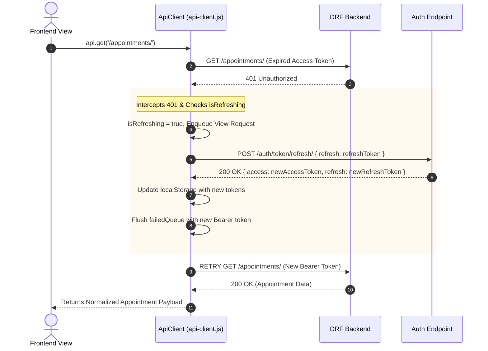

# VakCare — Frontend Architecture & Component Guide

## 1. Frontend Architecture Philosophy

The VakCare frontend is built with **Vanilla ES6 Modules** and a modern **Vanilla CSS Design System**. It requires **zero build-step bundling** during development, eliminating build overhead while delivering maximum responsiveness, instant page reloads, and deterministic browser execution.

### Architectural Highlights
- **Native ES6 Modules (`type="module"`)**: Code is organized into cohesive modules loaded natively by the browser.
- **Centralized API Client (`api-client.js`)**: Wraps `fetch()` with automatic Bearer token injection, request abort control, unified error normalizers, and concurrency-safe JWT token refresh with request queueing.
- **Session & Route Guarding (`auth.js`)**: Real-time client-side route protection verifying tokens, user profile cache, and backend validation.
- **Design Token System (`variables.css`)**: Tailored HSL color palette, typography scales, elevation shadows, radii, and transition timings.
- **Shared Components & Layout Injection (`components.js`, `ui.js`)**: Dynamic generation of responsive sidebars, topbars, live unread notification counters, confirmation modals, and toast alerts.

---

## 2. Directory Structure

```text
frontend/
├── index.html                   # Public marketing & platform landing page
├── login.html                   # Unified authentication portal (all roles)
├── register.html                # Patient self-registration portal
├── unauthorized.html            # 403 Forbidden role fallback page
├── not-found.html               # 404 Not Found error page
├── css/                         # Design token system & stylesheets
│   ├── variables.css            # Colors, spacing, shadows, radii tokens
│   ├── reset.css                # Modern box-sizing & margin normalizations
│   ├── global.css               # Base typography, utility classes, buttons
│   ├── components.css           # Cards, tables, modals, badges, toasts, inputs
│   ├── landing.css              # Marketing hero, feature showcases, trust badges
│   ├── auth.css                 # Login / Register split-screen layout
│   ├── dashboard.css            # Sidebar, topbar, grid workspace layouts
│   ├── forms.css                # Multi-column form layouts & validation states
│   └── responsive.css           # Mobile (<768px) and tablet (<1024px) media queries
├── js/                          # Core JavaScript modules
│   ├── config.js                # API URLs, roles, storage keys, specializations
│   ├── api-client.js            # Unified fetch wrapper with JWT refresh queue
│   ├── auth.js                  # Authentication, session manager, route guard
│   ├── components.js            # Shared sidebar & topbar layout injector
│   ├── ui.js                    # Modal dialogs, toast notifications, SVG icons
│   └── validation.js            # Client-side input validation helpers
└── pages/                       # Role-specific dashboard views
    ├── patient/                 # Patient Workspace (8 views)
    │   ├── dashboard.html       # Overview, health metrics, quick actions
    │   ├── doctors.html         # Specialist search, filter, and booking modal
    │   ├── appointments.html    # Upcoming / Past consultations & cancellations
    │   ├── medical-records.html # Chronological EHR records & AI summary
    │   ├── prescriptions.html   # Active medications, dosages, and notes
    │   ├── ai-assistant.html    # Multi-turn conversational health chat
    │   ├── notifications.html   # Notification center & read manager
    │   └── profile.html         # Demographics & emergency contact settings
    ├── doctor/                  # Healthcare Professional Portal (6 views)
    │   ├── dashboard.html       # Today's queue, appointment metrics, schedule
    │   ├── appointments.html    # Confirm, reject, cancel, complete workflows
    │   ├── patients.html        # Patient directory with consultation links
    │   ├── medical-records.html # Author clinical notes & review patient history
    │   ├── prescriptions.html   # Multi-item prescription issuance
    │   └── profile.html         # Consultation fees, biography, working hours
    └── admin/                   # Platform Governance Portal (7 views)
        ├── dashboard.html       # Platform KPIs, doctor verifications, audit alerts
        ├── users.html           # Platform user directory & roles
        ├── doctors.html         # Provision doctors & approve verifications
        ├── patients.html        # Registry of registered patients
        ├── appointments.html    # Master cross-department appointment ledger
        ├── audit-logs.html      # Security & compliance audit search
        └── reports.html         # Real-time analytics, KPIs, and charts
```

---

## 3. Core JavaScript Modules

### 3.1 API Client & Concurrency-Safe JWT Refresh (`frontend/js/api-client.js`)

The `ApiClient` class handles all HTTP communications with the backend:
1. **Automatic Bearer Injection**: Attaches `Authorization: Bearer <token>` to all protected endpoints.
2. **Transparent 401 Interception**: When an access token expires:
   - Sets `isRefreshing = true`.
   - Queues any simultaneous incoming requests into a `failedQueue`.
   - Calls `/api/v1/auth/token/refresh/` using the stored refresh token or HttpOnly cookie.
   - Upon receiving a new access token, updates storage, drains the `failedQueue`, and retries all original requests.
   - If token refresh fails, triggers `vakcare:session-expired` event and redirects to `login.html?session_expired=true`.
3. **Unified Response Extraction**: Strips DRF wrapping and throws standardized JavaScript error objects containing `status`, `code`, `message`, and `details`.



---

### 3.2 Authentication & Route Guarding (`frontend/js/auth.js`)

Page protection is handled via `Auth.guardRoute(allowedRoles)`:

```javascript
import { Auth } from '../../js/auth.js';
import { CONFIG } from '../../js/config.js';

// Guard this page to allow PATIENT only
const user = await Auth.guardRoute([CONFIG.ROLES.PATIENT]);
if (!user) return; // Automatic redirect occurred
```

1. **Local Check**: Verifies access token and user metadata in `localStorage`. If missing, redirects immediately to `login.html?redirect=<current_path>`.
2. **Server Verification**: Calls `/api/v1/auth/me/` to ensure the session has not been revoked on the server and that the user's role has not changed.
3. **Role Validation**: If the user's role is not within `allowedRoles`, redirects to `unauthorized.html`.
4. **Role Routing**: `Auth.redirectByRole()` directs users to their designated dashboard after authentication:
   - `PATIENT` $\rightarrow$ `/pages/patient/dashboard.html`
   - `DOCTOR` $\rightarrow$ `/pages/doctor/dashboard.html`
   - `ADMIN` $\rightarrow$ `/pages/admin/dashboard.html`

---

### 3.3 Dynamic Layout & Navigation Injection (`frontend/js/components.js`)

Each portal view includes a standard container `<div class="app-layout">` and calls:
```javascript
import { initAppLayout } from '../../js/components.js';

await initAppLayout({
  title: 'Appointments',
  subtitle: 'Manage upcoming consultations and past health history',
  breadcrumbs: ['Patient', 'Appointments']
});
```

This dynamically generates:
- **Responsive Sidebar**: Role-specific navigation items, active link highlighting, user avatar, and logout button.
- **Header Topbar**: Dynamic page title, breadcrumbs, search shortcuts, live notification bell with unread badge counter, and mobile menu hamburger button.
- **Automated Notification Polling**: Automatically queries `/api/v1/notifications/?unread=true` on load and updates the badge counter.

---

### 3.4 UI Helper Toolkit (`frontend/js/ui.js`)

- `showToast(message, type, duration)`: Non-blocking animated alert notifications (`'success'`, `'error'`, `'info'`).
- `showConfirmDialog({ title, message, confirmText, cancelText, isDanger })`: Async/await Promise-based confirmation modal for critical actions like cancellation or verification revocation.
- `ICONS`: Reusable inline SVG icons ensuring crisp rendering at any resolution with zero external icon font dependencies.
- `escapeHtml(str)`: Cross-site scripting (XSS) sanitizer for dynamic DOM insertions.
- `formatDate()`, `formatTime()`, `formatCurrency()`: Uniform localized date and fee formatters.

---

## 4. Role Portal Walkthroughs

### 4.1 Patient Portal (`/pages/patient/`)
- **Dashboard (`dashboard.html`)**: Quick KPI stat cards (Upcoming appointments, active prescriptions, recent medical records), shortcut buttons to find doctors, and health timeline previews.
- **Find Doctors (`doctors.html`)**: Real-time searchable directory with specialization filters (Cardiology, Dermatology, etc.), fee sliders, experience metrics, doctor biography drawers, and instant appointment booking modals.
- **My Appointments (`appointments.html`)**: Tabbed view of pending, confirmed, and past consultations with cancellation reason modal.
- **Medical Records (`medical-records.html`)**: Electronic Health Records (EHR) timeline with expandable clinical vitals (blood pressure, heart rate) and one-click "AI Medical Record Summarization".
- **Prescriptions (`prescriptions.html`)**: Detailed prescription cards showing prescribed medications, dosages, frequencies, courses, and doctor dietary notes.
- **AI Health Assistant (`ai-assistant.html`)**: Multi-turn conversational chat interface with chat history drawer, suggested specialization triage tags, emergency escalation alerts, and clinical disclaimer banners.
- **Notifications (`notifications.html`)**: Chronological notification feed with "Mark All as Read" action and deep links to relevant appointments.
- **Profile (`profile.html`)**: Demographic details, blood group, emergency contact person, relation, and address settings.

### 4.2 Doctor Portal (`/pages/doctor/`)
- **Overview Dashboard (`dashboard.html`)**: Daily consultation metrics, upcoming schedule breakdown, quick patient lookup, and profile availability toggle.
- **Consultations (`appointments.html`)**: Complete workflow management allowing doctors to Confirm pending bookings, Reject with clinical explanation, Cancel, or mark as Completed.
- **My Patients (`patients.html`)**: Directory of patients with active or previous consultations, providing direct access to authorized clinical records.
- **Medical Records (`medical-records.html`)**: Form to create and record formal clinical findings, vitals, and diagnostic notes for a patient.
- **Issue Prescription (`prescriptions.html`)**: Interactive prescription builder allowing dynamic addition/removal of medication rows with dosage, frequency, and duration inputs.
- **Doctor Profile (`profile.html`)**: Self-management of consultation fee, working hours (`09:00` - `17:00`), biography, and practice availability.

### 4.3 Administrator Portal (`/pages/admin/`)
- **Platform Dashboard (`dashboard.html`)**: High-level platform KPIs (total patients, verified doctors, all-time appointments, system health diagnostics).
- **User Directory (`users.html`)**: Platform-wide user management table with role badges, verification status, and contact details.
- **Manage Doctors (`doctors.html`)**: Provision new doctor accounts, review submitted medical licenses, and approve/revoke practitioner verifications.
- **Patient Registry (`patients.html`)**: Directory of registered patients with emergency contact summaries.
- **All Appointments (`appointments.html`)**: Cross-department consultation monitoring with date and status filters.
- **Compliance Audit (`audit-logs.html`)**: Security audit search table with event type filtering, actor lookup, and JSON detail inspect modal.
- **System Reports (`reports.html`)**: Real-time database aggregation metrics including appointment completion/cancellation rates and doctor workload distributions.
